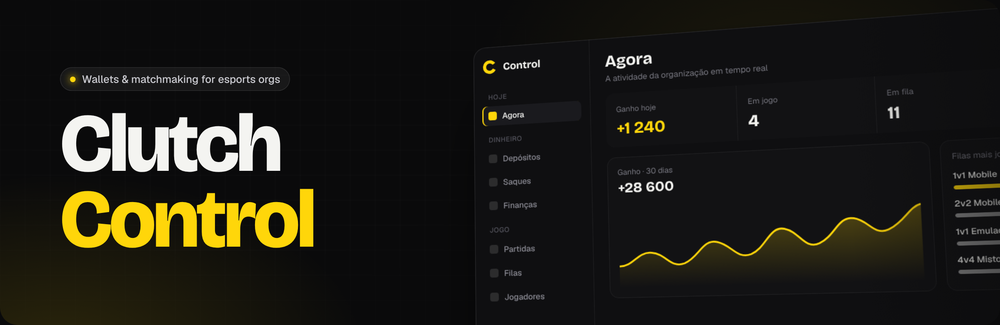
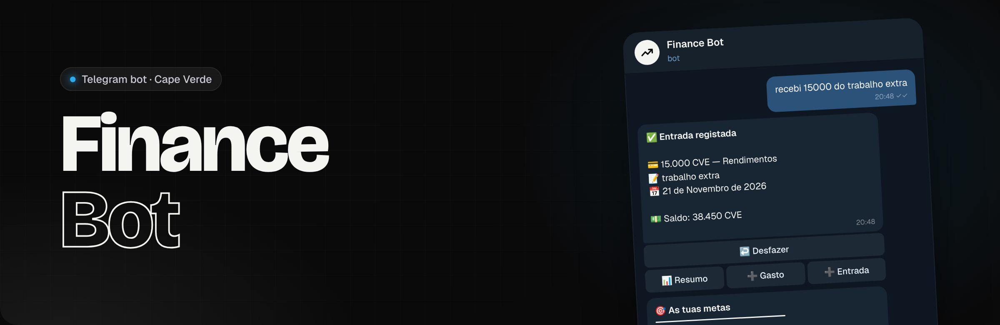
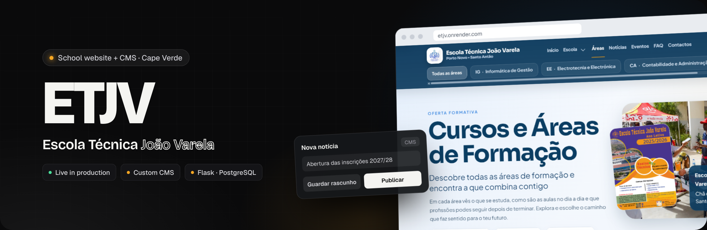
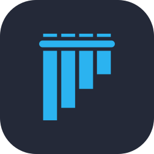
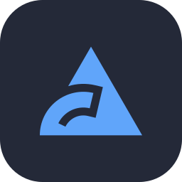

# Mohamed Sillah

### Junior Backend Developer · Python · TypeScript · PostgreSQL

*Building payment-adjacent systems for real users in Cape Verde and the PALOP countries.*

## 👋 About

Self-taught developer who builds **end to end**, from database schema to deployment.

Most of what I ship handles **real money or real users**: wallets, payments review, finance tools and school platforms.

I care about clean architecture, tests, and systems that keep working after launch.

> **📍 Based in** Cape Verde 🇨🇻
> **🎯 Focus** Backend engineering, fintech
> **💼 Open to** Backend roles in Cape Verde and Europe (remote or relocation)

 

## 🚀 Featured work

### Clutch Store

  

A Discord store for the PALOP countries with a web dashboard to run it: catalog, orders, payment confirmation and automatic delivery.

**What it does**
- Bank-transfer payments confirmed by staff, then **automatic delivery of single-use keys** per buyer
- Web dashboard with **admin and staff roles**, and a public storefront
- Bot and dashboard share one PostgreSQL database and talk through an internal API

**Stack** &nbsp;`Python` `discord.py` `React` `TypeScript` `Supabase` `PostgreSQL` `Vercel`

### Clutch Control

  

Wallet and matchmaking platform for esports organizations. Players hold a balance, join paid match queues, and staff review deposits and withdrawals.

**What it does**
- **Player wallets and ledger**: deposits, withdrawals, transfers, entry fees and payouts
- **Multi-tenant**: each organization has its own currency, payment methods and rules
- Discord bot and admin panel on a shared database
- Cut database egress by caching settings and plan data with event-based invalidation

**Stack** &nbsp;`TypeScript` `Node.js` `discord.js` `Drizzle` `React` `Supabase` `PostgreSQL` `Railway`

### Finance Bot

 

Personal finance assistant on Telegram. Users log and manage money by chatting in natural language, including Cape Verdean Portuguese.

**What it does**
- **Multi-provider AI routing** (Gemini, Groq, OpenRouter) with fallback and a circuit breaker
- **Regex fallback engine** so the bot keeps working when every provider is rate limited
- Budgets, savings goals, installments, split expenses, recurring transactions and receipt OCR
- Migrated to PostgreSQL, with a security hardening pass and a pytest suite

**Stack** &nbsp;`Python 3.12` `python-telegram-bot` `PostgreSQL` `pytest`

### School Website + CMS

 

Institutional website for a public technical school in Cape Verde, with a CMS so staff can publish without a developer.

**Stack** &nbsp;`Python` `Flask` `PostgreSQL` `Render`

### DevFlow
 

Freelancer dashboard: projects, clients, finances and investments in one place. A React web app and a PyQt6 desktop client share one Supabase backend.

**What it does**
- Supabase Auth with an email allowlist and **Row Level Security on every table**
- Versioned SQL migrations and Zod validation

**Stack** &nbsp;`React 19` `TypeScript` `Vite` `PyQt6` `Supabase`

## 🛠️ Stack

**Languages** 

**Backend & data** 

**Bots** 

**Frontend & desktop** 

**Infra** 

**Testing & quality** 

**Currently learning** 

 

## 📊 Activity

**Open to backend engineering opportunities in Cape Verde and Europe.**

