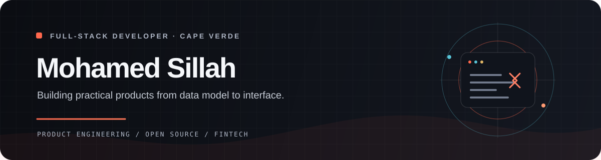

  

  
<strong>Full-Stack Developer · Mindelo, Cape Verde</strong>

  
I build practical software for real workflows — from data models and APIs to clear, usable interfaces.

  

    <a href="https://www.linkedin.com/in/mohamed-sllh">LinkedIn</a> ·
    <a href="mailto:mohamedsillahhh@gmail.com">Email</a> ·
    <a href="https://github.com/Mohamed-Sll?tab=repositories">All repositories</a>
  

## About me

I’m a full-stack developer who enjoys making products understandable, reliable, and useful. My work spans web applications, APIs, automation, and data-focused tools. I care about the details behind a feature: validation, permissions, persistence, testing, and how someone will run the project after cloning it.

- **Based in:** Mindelo, São Vicente, Cape Verde
- **Interested in:** Full-stack and backend-focused opportunities
- **Currently exploring:** product engineering, financial workflows, and open-source software

## Selected projects

### [HackHub](https://github.com/Mohamed-Sll/hackhub-platform)
An open-source platform for discovering and organizing hackathons, events, teams, and participant workflows.

- **Stack:** Next.js, TypeScript, React, FastAPI, Python, SQLite
- **Preview:** [Open the frontend preview](https://frontend-40uspsv0q-mohamedsillahhh-clouds-projects.vercel.app) — this is a frontend preview; the API and database are not hosted there.

### [DevFlow](https://github.com/Mohamed-Sll/DevFlow)
A local-first workspace for freelancers to manage projects, finances, tracked hours, and investments. The web version stores data in the browser with IndexedDB and works without an account or cloud sync.

- **Stack:** React, TypeScript, Vite, IndexedDB, Dexie
- **Focus:** private local data, offline-friendly workflows, and exportable records

### [Comparador de Remessas](https://github.com/Mohamed-Sll/Comparador-de-remessas)
A tool for comparing money-transfer options to Cape Verde, with the received amount as the key comparison.

- **Stack:** React, TypeScript, Vite, FastAPI, Python, PostgreSQL
- **Focus:** clear comparisons and practical financial information

### [Pomodoro Focus Bot](https://github.com/Mohamed-Sll/Bot-de-foco-Pomodoro-streaks-)
A Telegram bot for focused work sessions, breaks, streaks, and productivity tracking.

- **Stack:** Python, FastAPI, Telegram Bot API, SQLite / PostgreSQL

## Technologies

**Languages:** Python, TypeScript, JavaScript, SQL  
**Frontend:** React, Next.js, Vite, Tailwind CSS  
**Backend & data:** FastAPI, Flask, Node.js, PostgreSQL, SQLite, IndexedDB  
**Quality & delivery:** pytest, Vitest, GitHub Actions, Docker, Vercel, Render

I’m always learning and improving these projects in public. If something catches your eye, the repository README has setup instructions, current limitations, and the most accurate details about that project.
